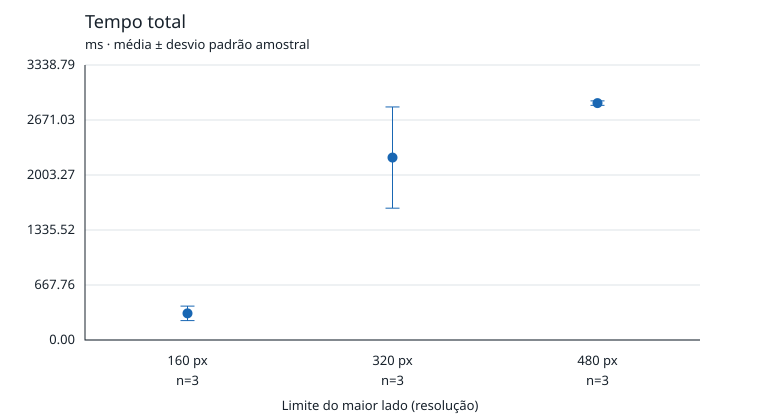
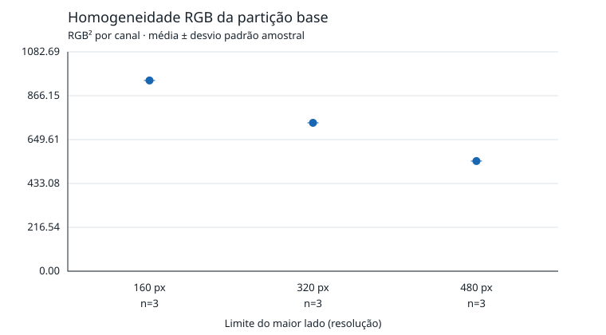

# Benchmark de segmentação

Sumarização de dados existentes; nenhuma nova medição foi realizada.

Médias ± desvios padrão amostrais; mediana, mínimo e máximo no CSV.
Barras de dispersão não são intervalos de confiança.
O MSE entre resoluções não testa monotonicidade da hierarquia: são imagens diferentes.

| Resolução | n | Tempo total (ms) | MSE RGB |
|---:|---:|---:|---:|
| 160 | 3 | 323.533 ± 87.864 | 941.4680 ± 0.0000 |
| 320 | 3 | 2215.007 ± 614.501 | 732.3830 ± 0.0000 |
| 480 | 3 | 2876.160 ± 27.134 | 543.6830 ± 0.0000 |

