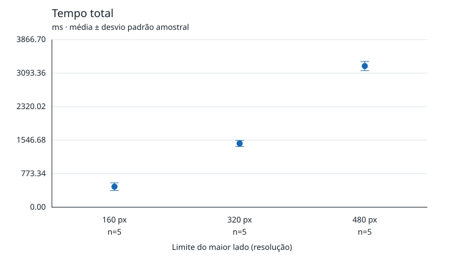
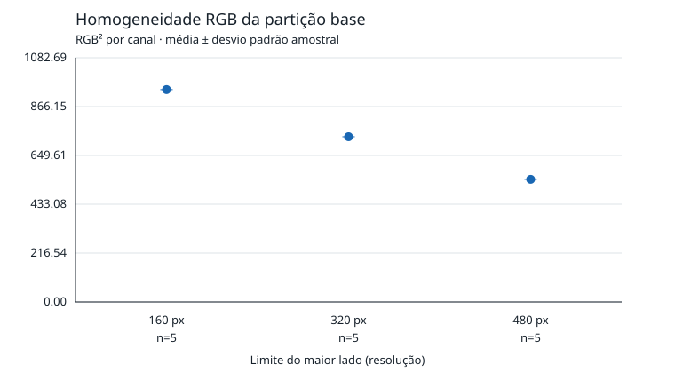

# Benchmark de segmentação

Medições novas, sequenciais, após aquecimento por resolução.

Médias ± desvios padrão amostrais; mediana, mínimo e máximo no CSV.
Barras de dispersão não são intervalos de confiança.
O MSE entre resoluções não testa monotonicidade da hierarquia: são imagens diferentes.

| Resolução | n | Tempo total (ms) | MSE RGB |
|---:|---:|---:|---:|
| 160 | 5 | 474.313 ± 89.258 | 941.4680 ± 0.0000 |
| 320 | 5 | 1471.354 ± 70.062 | 732.3830 ± 0.0000 |
| 480 | 5 | 3257.306 ± 105.041 | 543.6830 ± 0.0000 |

