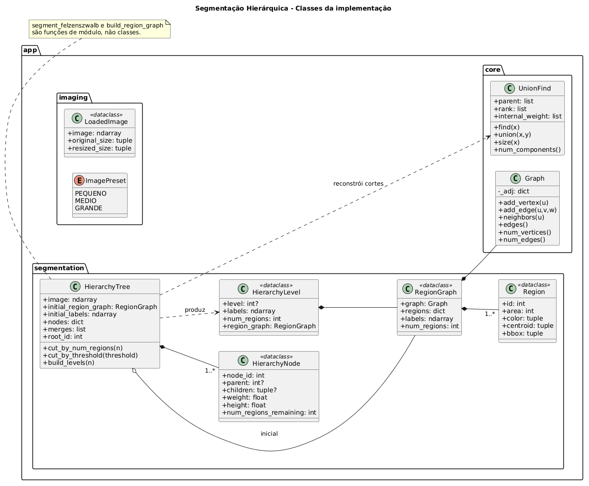
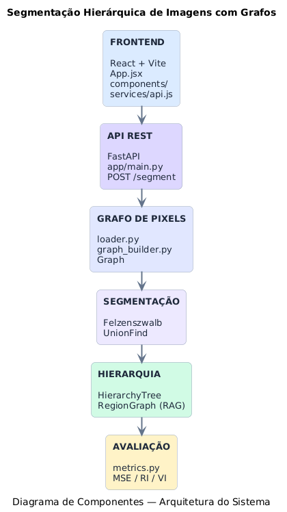
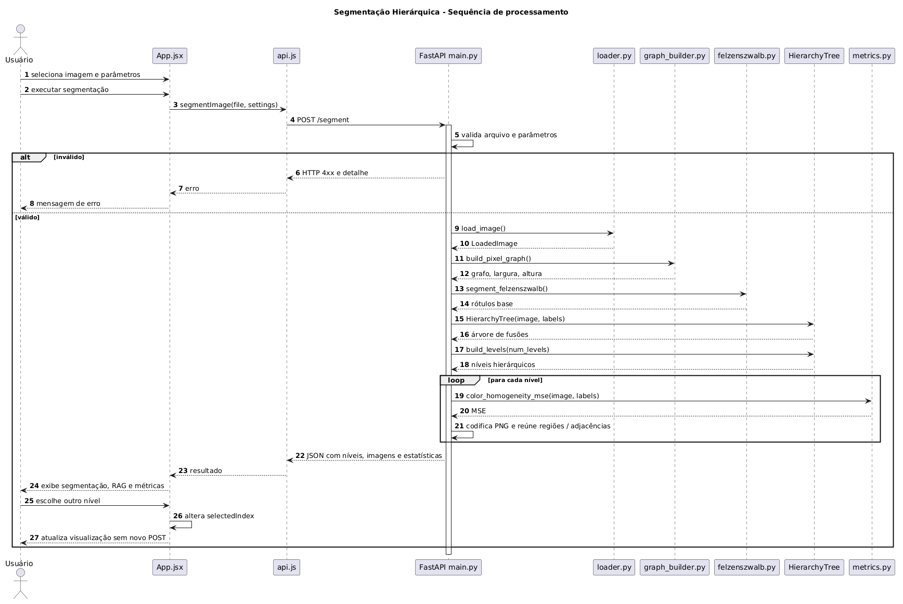

# Modelagem e Planejamento da Solução

**Projeto:** Segmentação Hierárquica de Imagens Baseada em Grafos  
**Disciplina:** Teoria dos Grafos e Computabilidade  
**Instituição:** PUC Minas

## 1. Definição do problema

A segmentação de imagens consiste em dividir uma imagem digital em regiões que compartilham determinadas características visuais.

O problema abordado neste projeto é a construção de uma ferramenta capaz de representar imagens como grafos ponderados e agrupar pixels semelhantes, permitindo explorar diferentes níveis de detalhamento.

A solução deve construir uma hierarquia de partições e representar as relações espaciais entre regiões por meio de grafos de adjacência.

## 2. Justificativa da modelagem

A utilização de grafos é adequada porque permite representar explicitamente as relações entre pixels vizinhos.

Cada pixel é modelado como um vértice, enquanto cada aresta representa uma relação espacial entre dois pixels. O peso da aresta expressa sua dissimilaridade de cor.

Essa abordagem possibilita aplicar algoritmos de agrupamento e estruturas de conjuntos disjuntos para identificar componentes semelhantes.

A organização hierárquica oferece diferentes perspectivas da mesma imagem, desde segmentações detalhadas até agrupamentos mais amplos.

## 3. Estrutura matemática

Seja uma imagem de largura W e altura H.

A representação utiliza um grafo ponderado não direcionado G = (V, E, w), em que:

- **V:** conjunto de vértices correspondentes aos pixels.
- **E:** conjunto de arestas entre pixels vizinhos.
- **w:** função de peso que representa a diferença entre as cores.

A quantidade de vértices é igual a W × H.

A ferramenta admite conectividade de quatro ou oito vizinhos.

No espaço RGB, o peso entre dois pixels é calculado pela distância euclidiana entre seus três canais de cor. Também há suporte ao espaço CIELAB.

## 4. Algoritmos e estruturas de dados

**Graph:** estrutura própria para armazenar vértices, arestas ponderadas e listas de adjacência.

**Union-Find:** estrutura de conjuntos disjuntos utilizada para identificar e unir componentes durante o processamento.

**Felzenszwalb–Huttenlocher:** algoritmo utilizado na segmentação inicial, considerando diferenças internas e externas das componentes.

**HierarchyTree:** estrutura responsável por registrar fusões sucessivas de regiões e permitir cortes hierárquicos.

**RegionGraph (RAG):** representa as relações de adjacência entre as regiões existentes em cada nível.

Os algoritmos de processamento do grafo foram implementados no projeto, sem dependência de bibliotecas prontas de algoritmos de grafos.

## 5. Dados utilizados

O sistema recebe imagens digitais fornecidas pelo usuário.

A avaliação experimental principal utiliza a imagem `data/raw/carro.jpg`, disponível no repositório.

Foram avaliadas resoluções máximas de 160, 320 e 480 pixels, preservando a proporção da imagem.

Outros exemplos de processamento encontram-se em `data/results/`.

## 6. Arquitetura proposta e implementada

O sistema é dividido em duas partes principais.

**Backend — Python e FastAPI**

Responsável pelo carregamento de imagens, construção dos grafos, segmentação, hierarquização, cálculo das métricas e disponibilização dos resultados pela API REST.

**Frontend — React e Vite**

Responsável pelo envio de imagens, configuração dos parâmetros, exibição das segmentações, navegação pelos níveis, visualização dos RAGs e apresentação das métricas.

O frontend utiliza o resultado retornado pela API para atualizar as visualizações sem executar novamente o processamento a cada mudança de nível.

## 7. Planejamento e organização do desenvolvimento

O trabalho foi organizado nas seguintes frentes, posteriormente consolidadas no repositório:

1. Definição do problema e modelagem matemática do grafo de pixels.
2. Implementação das estruturas Graph e Union-Find.
3. Construção do grafo e desenvolvimento da segmentação inicial.
4. Implementação da hierarquia e dos grafos de adjacência.
5. Desenvolvimento da API e da interface gráfica.
6. Implementação de métricas e testes automatizados.
7. Realização de experimentos e análise de desempenho.
8. Elaboração dos diagramas UML e do artigo científico.
9. Preparação da demonstração e dos materiais de entrega.

O histórico de commits documenta a evolução das implementações e das contribuições individuais.

## 8. Estratégia de validação

A correção da solução é avaliada por testes automatizados executados com pytest.

Entre as propriedades verificadas estão a validade das partições, o aninhamento dos níveis hierárquicos, a consistência das fusões e a não diminuição do MSE durante o agrupamento de regiões da mesma imagem.

O desempenho é avaliado por benchmark reproduzível, utilizando medições repetidas e cálculo de médias e desvios padrão amostrais.

## 9. Complexidade e limitações

Para uma imagem com N pixels e conectividade limitada, o grafo possui O(N) vértices e arestas.

A ordenação das arestas na segmentação inicial possui custo O(E log E). A estrutura Union-Find utiliza compressão de caminho e união por posto para reduzir o custo das operações sobre componentes.

A implementação apresenta limitações relacionadas ao crescimento do custo computacional com a resolução e à utilização predominante de diferenças locais de cor.

A ferramenta identifica regiões semelhantes, mas não realiza reconhecimento semântico automático de objetos.

## 10. Artefatos da modelagem

Os três diagramas UML estão disponíveis neste diretório:

**Diagrama de Classes**

**Diagrama de Componentes**

**Diagrama de Sequência**

## 11. Resultado da solução

O protótipo desenvolvido permite realizar segmentação hierárquica, navegar pelos níveis, consultar grafos de adjacência e analisar métricas de homogeneidade e desempenho.

O código-fonte, os testes e os experimentos encontram-se versionados no repositório do projeto.

A documentação matemática e experimental complementar está disponível em `docs/relatorio/`.
